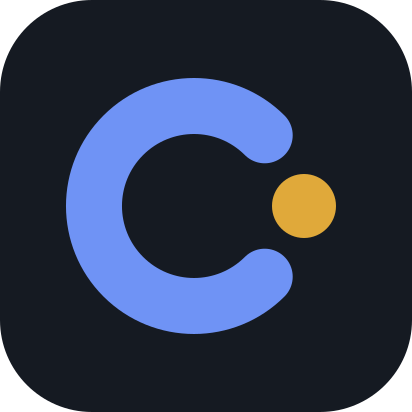
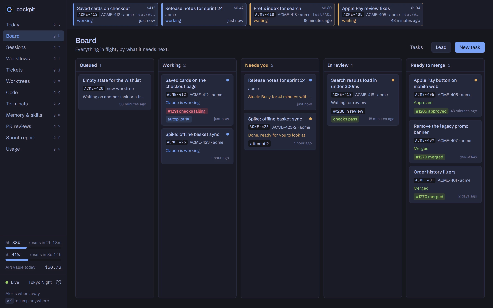
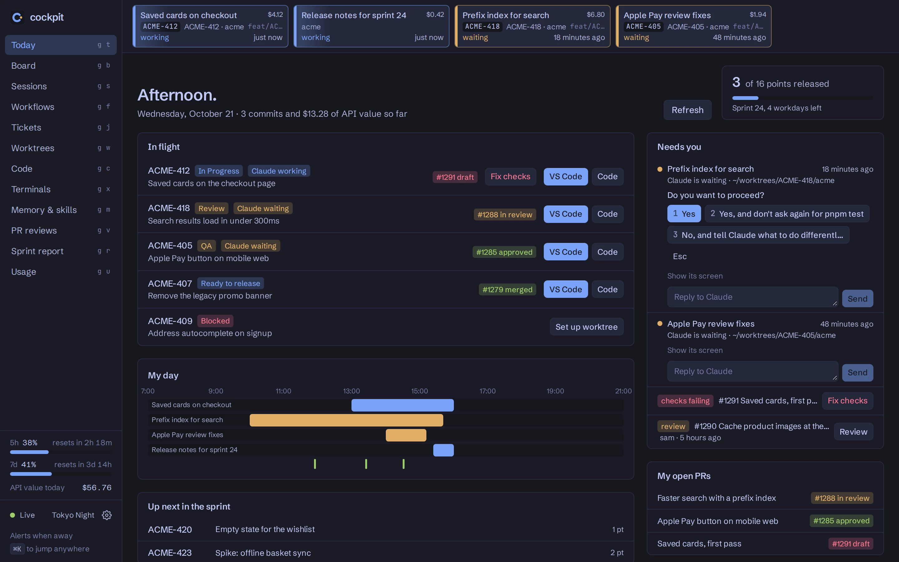
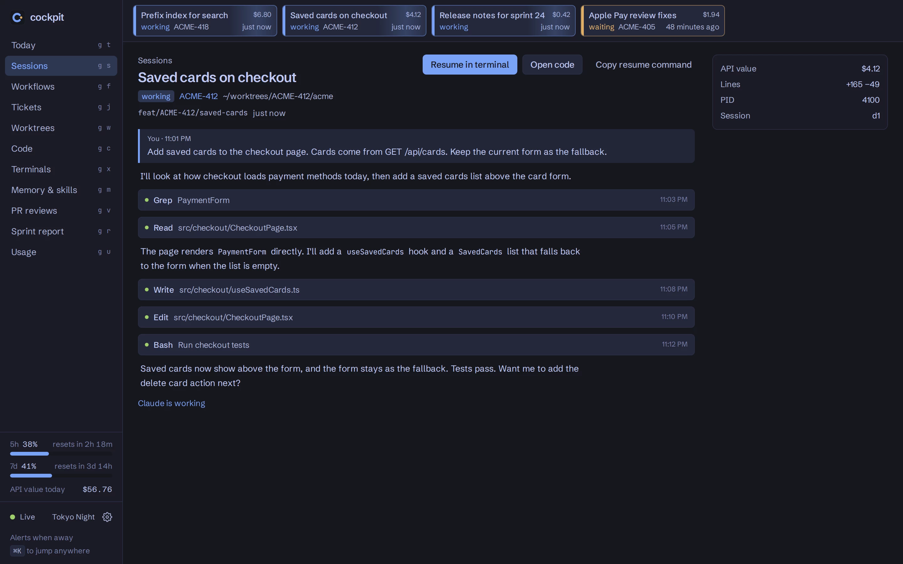
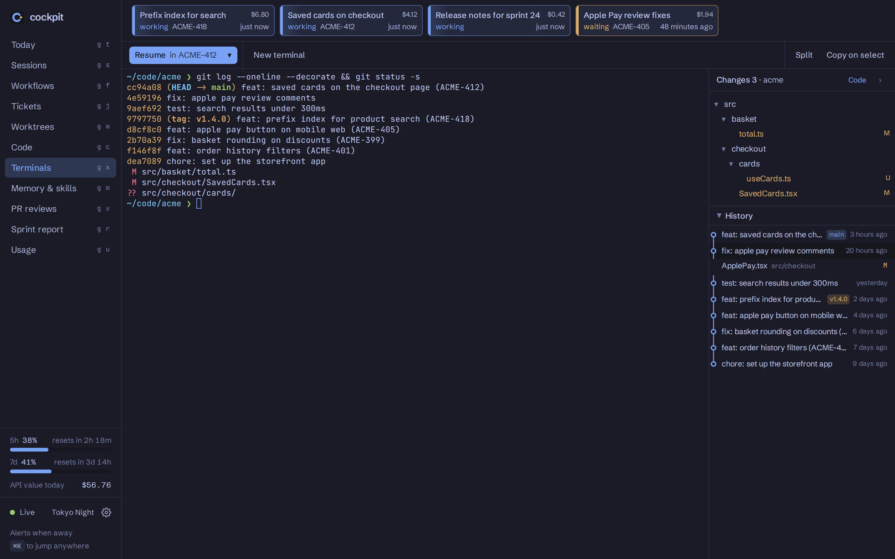
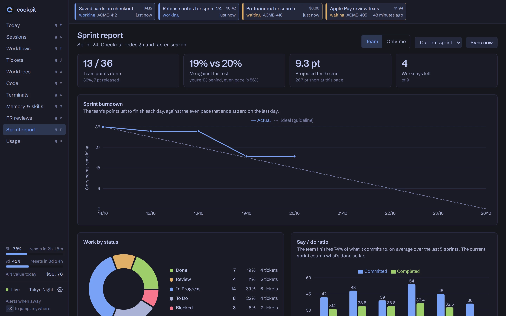
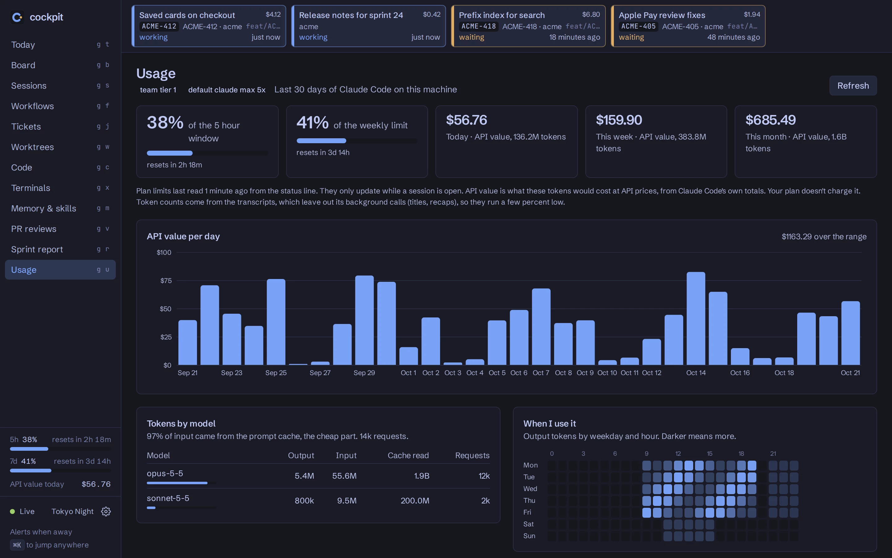
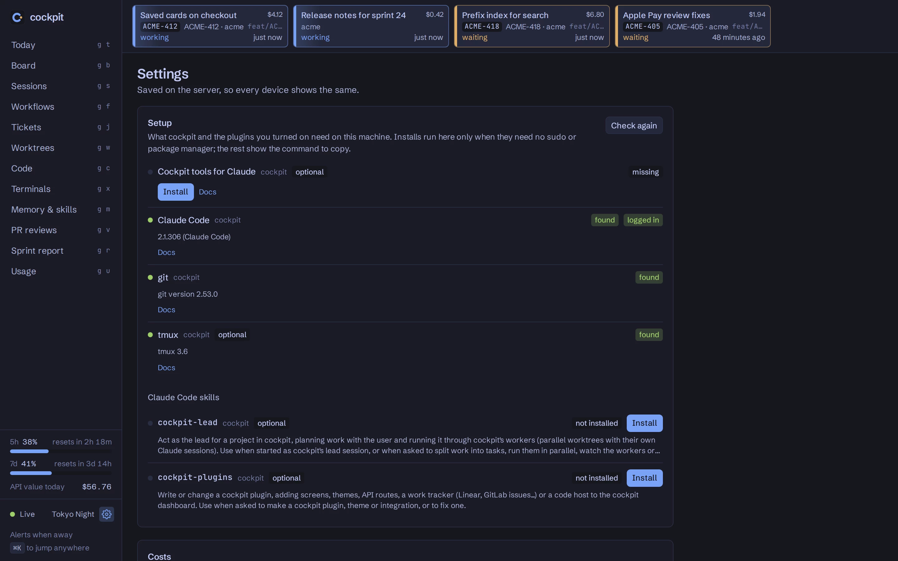
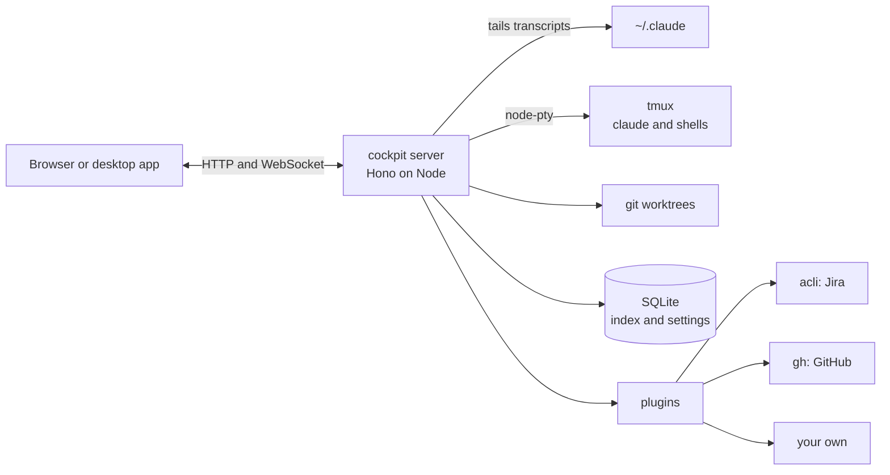

<div align="center">



# cockpit

**A self-hosted dashboard for Claude Code**

Live sessions, browser terminals, worktrees, git and your tracker in one place

Open source • Self-hosted • Extensible with plugins

[](LICENSE)
[](https://nodejs.org)
[](#installation)
[](https://docs.anthropic.com/en/docs/claude-code)
[](CONTRIBUTING.md)

[Features](#features) • [Installation](#installation) • [Plugins](#plugins) • [How it works](#how-it-works) • [Contributing](#contributing)


</div>

---

## Contents

- [Introduction](#introduction)
- [Why cockpit?](#why-cockpit)
- [Features](#features)
- [Installation](#installation)
- [Features in action](#features-in-action)
- [Plugins](#plugins)
- [How it works](#how-it-works)
- [Security](#security)
- [For developers](#for-developers)
- [Limitations](#limitations)
- [Contributing](#contributing)
- [License](#license)
- [Acknowledgements](#acknowledgements)

## Introduction

Cockpit runs on the machine where you use Claude Code and puts your work in a browser tab. You can watch every Claude session as it runs, open terminals in the browser that survive a reload, and see each ticket next to its worktree, branch, pull request and sessions.

It reads the files Claude Code already writes in `~/.claude`, so you don't have to change how you work. Jira, GitHub and Tailscale come as plugins that you can turn off, replace with your own, or add to.

## Why cockpit?

Claude Code is good at running several jobs at once, and that's when it gets hard to keep track:

- Sessions run in five terminals and you forget which one is waiting for you.
- Worktrees pile up and you can't tell which ones are safe to delete.
- The ticket, the branch, the PR, its checks and the Claude session that did the work all live in different places.
- The dollar figure Claude Code reports is a real bill on an API key but only a comparison on a Pro or Max plan, and nothing tells you which.

Cockpit puts all of that behind one port. It's a server you run yourself, and nothing leaves your machine.

## Features

- **Live sessions.** A strip of every running Claude session. It sweeps while Claude works, turns amber when Claude asks you something (a question, a permission prompt or a dialog) and goes grey once it has just finished its turn. You get a notification when one needs you, and the tab title shows the count.
- **Work.** Every worktree, session outside a worktree and queued task is a card on the board. Each card sits in the column that says what it needs next: queued, working, needs you, in review or ready to merge. Cards show the PR, its checks and the session. A busy session that has written nothing new for a while is flagged as stuck.
- **Replies without the terminal.** Answer a permission prompt or type a reply to a running session from the Board, Today, the session strip or its transcript. This works for sessions running in cockpit's terminals.
- **Autopilot.** Turn it on for a worktree and its PR's failing checks and requested changes go back to its Claude session, with the check logs and the review comments. After a set number of tries it stops and tells you.
- **Checks before the PR.** Set `repo.verifyCommand` and cockpit runs it in a worktree each time its session finishes. A failure moves the card to Needs you, with a button that sends the output to Claude.
- **Tasks.** Queue some work and cockpit creates the worktree and starts Claude there with your prompt. It keeps to a limit on how many tasks run at once, and holds new ones when the 5-hour limit is nearly used. A task can run up to 4 attempts, which you compare side by side before keeping one. Tasks can wait for other tasks, so a plan runs in waves. They're listed under Queued and attempts on Work.
- **A lead session.** Cockpit ships an MCP server and a `cockpit-lead` skill. With them, one Claude session plans the work with you, queues the tasks, watches the workers and answers them.
- **Review before the PR.** Read a worker's diff, leave notes on its lines and send them all to its session as one message.
- **Runs.** Tests, lint, typechecks, audits, E2E runs, proofs, verify and CI checks in one list, each linked to its ticket and worktree, with its output, steps and videos. They come from a Claude Code hook, the `cockpit run` wrapper, terminals and plugins. A failed run can be sent to the Claude session that ran it, or run again in a terminal.
- **Previews.** With `repo.devCommand` set, the Board starts a worktree's dev server on a free port and shows it.
- **While you were away.** After a break, Today lists what finished, failed or waited for you. The Phone push plugin sends notifications to ntfy or Pushover, plus a second, urgent one for a session left waiting.
- **Transcripts.** Any session in full, with tool calls, subagents and cost, updating as it runs. Full-text search covers everything said in every session.
- **Browser terminals.** They run in tmux, so they survive a page reload or a server restart. You get split shells next to Claude, search, copy on select and clickable links, and you can paste or drop images straight into Claude.
- **Git next to the terminal.** The changes in the terminal's repo and its commit history with a branch graph. A commit opens to its files, and a file opens to its diff.
- **Worktrees.** A tab on Tickets with each worktree's size on disk, dirty files and ahead/behind, plus a cleaner that finds the ones whose work has shipped.
- **Code.** A file tree, the Monaco editor, a diff against HEAD, git grep, and stage, commit and push.
- **Tickets and sprints.** Your sprint from the tracker, each ticket with its PR, CI state and Claude session. From there you can create its worktree, open it in VS Code, or start or resume Claude on it.
- **Reports.** The sprint report has a burnup of released points, the time each ticket spent in each status, Claude cost per ticket and a day-by-day log. The Week tab sums up your week and has a daily update you can polish with Claude. Usage is the third tab.
- **PR reviews.** Start a Claude review of a pull request, or let Claude fix failed checks and answer review comments.
- **Memory and skills.** An editor for CLAUDE.md, memories, skills, plans, settings and saved workflows. Every save keeps a backup you can diff and restore. It opens from Settings and ⌘K, and Settings → Screens can put it and Code back in the sidebar.
- **Usage.** The 5-hour and weekly plan limits, tokens by model and a heatmap of when you use Claude, plus the tools and shell commands that use the most tokens. Cockpit works out from your Claude login whether the dollars are a real bill and labels them "API value" when they aren't. You can also hide them.
- **Themes and fonts.** 26 themes from well-known editor palettes, with 34 more in a plugin. Auto follows the system's light or dark mode. Any font installed on your device can be used for the interface and for code.
- **Plugins.** They add screens, themes, API routes, event listeners and Claude Code skills, or replace the tracker, the code host or the way in from other devices.
- **Setup in the app.** Settings → Setup checks every tool, login, token and skill that cockpit and your plugins need. It installs what it safely can and opens a terminal for logins.
- **Everywhere else.** A command palette on ⌘K, `g` shortcuts for every page, a phone layout, and an optional desktop app with a menu bar count.

## Installation

### Requirements

- Linux or macOS
- [Node.js 22](https://nodejs.org) and [pnpm](https://pnpm.io)
- [git](https://git-scm.com) and [Claude Code](https://docs.anthropic.com/en/docs/claude-code)
- [tmux](https://github.com/tmux/tmux). It's optional, but without it terminals don't survive a restart.
- The CLIs of the plugins you turn on: [`gh`](https://cli.github.com) for GitHub and [`acli`](https://developer.atlassian.com/cloud/acli/) for Jira

You don't need all of it before you start. Once cockpit is running, Settings → Setup shows what's missing.

### Quick start

Clone this repository, then:

```sh
pnpm install
cp config.example.toml config.local.toml   # point repo.path at your main repo
pnpm build
pnpm start                                 # http://127.0.0.1:8770
```

Then, in Settings:

1. **Setup**: install or log in to anything that's missing.
2. **Plugins**: turn on Jira or GitHub and fill in the board or repo.
3. **Screens**: hide anything you don't use.

To look around with made-up data first, run `COCKPIT_DEMO=1 COCKPIT_CONFIG=config.example.toml pnpm start`.

### Keep it running

```sh
bin/cockpit service install
```

This starts cockpit now and at every login, as a systemd user service on Linux or a launchd agent on a Mac. It uses this checkout and the PATH of the shell you run it from, so node, claude and the plugins' CLIs are found the same way. `bin/cockpit service status` shows whether it's running, and `uninstall` removes it. `deploy/cockpit.service` is the same unit written by hand, if you'd rather set it up yourself.

### More than one machine (optional)

Cockpit can run as a hub on the computer you look at, with the terminals, Claude sessions, repo and automations on an always-on node. Automations keep going while the hub sleeps, and the hub catches up when it wakes. See [docs/remote.md](docs/remote.md) for setting it up, or for moving a cockpit you already use.

### Open it from other devices

Out of the box cockpit only answers the machine it runs on. To use it from a laptop or a phone, turn on an access plugin. The bundled Tailscale plugin lets one Tailscale login in through `tailscale serve`:

```sh
tailscale serve --bg --https=8444 http://127.0.0.1:8770
```

Then turn on Tailscale in Settings → Plugins and enter your login. For a VPN, a reverse proxy with its own sign-in, or anything else, you can write an access plugin (see [plugins/PLUGINS.md](plugins/PLUGINS.md)).

### Desktop app (optional)

A small Electron wrapper for the computer in front of you, while the server stays on your dev box. It adds a menu bar item showing how many sessions are working and waiting, a count of the sessions working or waiting for you on the app icon, and ⌘⇧K to open it from anywhere. Back and forward work from buttons next to the window controls, ⌘[ and ⌘] (Alt+← and Alt+→ on Linux), the mouse's side buttons and a three-finger swipe, and the Go menu jumps to a page with ⌘1 to ⌘8.

```sh
./desktop/install.sh https://your-server.example.com:8444
```

On macOS it builds `~/Applications/cockpit.app`. On Linux it adds cockpit to the app menu.

### A lead session (optional)

Settings → Setup has **Cockpit tools for Claude**, which adds cockpit's MCP server to Claude Code (`claude mcp add --scope user cockpit ...`), and the `cockpit-lead` skill. With both installed, **Lead** on the Board opens a Claude session in your repo that can see the Board, queue tasks, read a worker's screen and reply to it. It never merges anything, and it asks you before approving anything risky. The tools talk to cockpit on `127.0.0.1`, or on `COCKPIT_URL` if you set it.

### Recording runs (optional)

Settings → Board and automation has **Install the hook**. It adds a `PostToolUse` and `PostToolUseFailure` hook for Bash to `~/.claude/settings.json`, leaving your other hooks alone. From then on, the tests, lint, typechecks, audits and E2E runs that Claude runs show on Runs. **Remove** takes it out again. The same settings say which commands count as which kind of run.

To record a command yourself, from a skill or a git hook, wrap it:

```sh
bin/cockpit run --kind audit -- pnpm audit
bin/cockpit run --name "checkout flow" --artifact report.html -- pnpm e2e
```

It streams the output to cockpit and exits with the command's exit code. If cockpit is down, the command runs as normal. Without the hook, Claude can report what it ran with the `report_run` tool from cockpit's MCP server.

## Features in action

### Work

Every worktree, session and task, sorted by what it needs next. Open a card to reply to its session, review its changes, run its checks or turn on autopilot.



### Today

How much of your work is in each column on Work, the first things that need you, the sprint and your day on a timeline.



### Sessions

Any Claude session, live, with its tool calls, subagents and cost.



### Terminals and git

Claude and your shells side by side, with the repo's changes and history next to them. Click a commit to see its files, and a file to see its diff.



### Sprint report

Points released over the sprint, how long each ticket spent in each status, and what Claude cost per ticket.



### Usage

Plan limits, tokens by model and when you use Claude.



### Settings

Setup, costs, fonts, screens and plugins, all in the app.



## Plugins

A plugin is a folder with a `plugin.json`, plus an optional `server.ts`, themes, assets and skills. Cockpit reloads a plugin when its files change, and a broken plugin shows its error without taking the rest of the app down.

| Plugin | What it does |
| --- | --- |
| **Jira** | Tickets, sprints and epics through Atlassian's `acli`. Feeds Tickets, the Sprint report, Today and the worktree cleaner. |
| **GitHub** | Your PRs, their checks and the review queue through `gh`. Feeds PR badges, PR reviews and fixing failed checks. |
| **Phone push** | Sends notifications to your phone through ntfy or Pushover, with a high-priority push for sessions left waiting. Off by default. |
| **Meetings** | Records meetings on your computer (your mic plus the meeting app's sound), and the desktop app can start and stop by itself when Zoom, Teams, Meet or another meeting app uses the mic. Transcribed locally with Whisper as it goes, then Claude writes each one up for its kind (stand-up, planning, 1:1, interview, retro, or your own) and links recurring meetings into a series, so each one shows what changed and ticks off what got done. Off by default. |
| **Ideas** | Every idea and project you have for later, by project: capture one in a line, give it a status, notes in Markdown, a group, a phase and an estimate, and hand it to Claude to plan in the project's folder. Ships a skill so Claude sessions can save ideas too. Off by default. |
| **Tailscale** | Lets one Tailscale login in from other devices. |
| **Extra themes** | 34 more themes, as JSON files with no code. |
| **Example** | A small plugin to copy from: one screen, two routes, a setting and a listener. |

Your own plugins go in `data/plugins`, or in `pluginsDir` if you set it in the config. Settings → Plugins can install one from a git link too, showing what it asks for before anything of it runs. A plugin of yours with the same id as a bundled one replaces it. That way you can turn Jira into Linear, GitHub into GitLab, or add a screen only your team needs.

[plugins/PLUGINS.md](plugins/PLUGINS.md) covers the whole API. It's written for people and for Claude, and the bundled `cockpit-plugins` skill points Claude at it, so you can ask Claude to write a plugin for you.

## How it works



- The server reads Claude Code's session registry to know what's running. It tails each JSONL transcript by byte offset, so following a 250 MB transcript costs almost nothing. A SQLite index keeps the title, branch and cost of every session.
- Replies go to the session's tmux pane: text as a bracketed paste, menu answers as key presses. Permission prompts aren't written to the transcript, so cockpit reads the pane to find the question and its options.
- Terminals live in their own tmux server, so restarting cockpit only drops the browser's connection and the terminal keeps running.
- Trackers and code hosts are providers that plugins register. Core pages ask whichever one is active, and leave out their ticket or PR parts when there isn't one.
- The Jira CLI doesn't give status history, so cockpit takes an hourly snapshot of the sprint and records every change itself. The burnup and the status lanes come from those changes.

## Security

Anyone who can reach cockpit gets a terminal on your machine, so treat access to it like SSH access. It listens on `127.0.0.1` and only answers direct requests from that machine. A request from anywhere else, or through a proxy, gets a 401 unless an access plugin lets it in. Plugin tokens stay on the server, and the browser only sees their last four characters. Plugins run with full access, like editor extensions, so only install ones you trust.

[SECURITY.md](SECURITY.md) has the details and explains how to report a vulnerability.

## For developers

```sh
pnpm dev                      # Vite on 8771, with the API proxied to 8770
pnpm build && pnpm test       # type checks, builds and unit tests
pnpm smoke                    # every page in a headless browser, in demo mode
node scripts/screenshots.mjs  # the README images, from demo data
```

The repo is a pnpm workspace with three packages:

- `server/`: Hono, node-pty and SQLite
- `web/`: React, TanStack Router and Query, Tailwind, xterm.js and Monaco
- `shared/`: types, themes and the plugin API

## Limitations

- Status history starts the first time you run cockpit, so older sprints only show the last status change the tracker knows about.
- Replies only reach sessions running in cockpit's terminals. A session started somewhere else is resumed in a cockpit terminal instead.
- Autopilot needs a code host plugin that reports checks and review comments, like the bundled GitHub one.
- The worktree commands are templates in the config. Setups that aren't plain `git worktree` need their own.
- Windows isn't supported. WSL might work, but nobody has tested it.

## Contributing

Bug reports, fixes, plugins and themes are all welcome. [CONTRIBUTING.md](CONTRIBUTING.md) explains how to get set up. Please open an issue before you start on anything large.

## License

MIT. See [LICENSE](LICENSE).

## Acknowledgements

- [Claude Code](https://docs.anthropic.com/en/docs/claude-code), which cockpit is built around
- [xterm.js](https://xtermjs.org), [Monaco](https://microsoft.github.io/monaco-editor/) and [tmux](https://github.com/tmux/tmux) for the terminals and the editor
- [Hono](https://hono.dev), [TanStack](https://tanstack.com), [Tailwind CSS](https://tailwindcss.com), [Recharts](https://recharts.org) and [cmdk](https://cmdk.paco.me)
- The authors of the editor palettes the themes come from, including Dracula, Nord, Catppuccin, Gruvbox, Solarized, Tokyo Night and Rosé Pine
- [Schibsted Grotesk](https://github.com/schibsted/schibsted-grotesk) and [JetBrains Mono](https://www.jetbrains.com/lp/mono/), the built-in fonts
